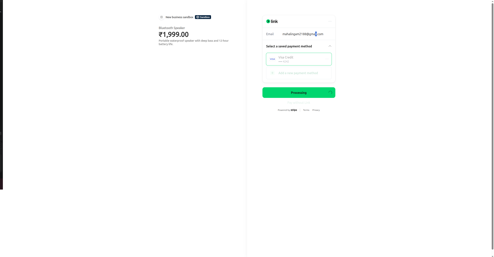
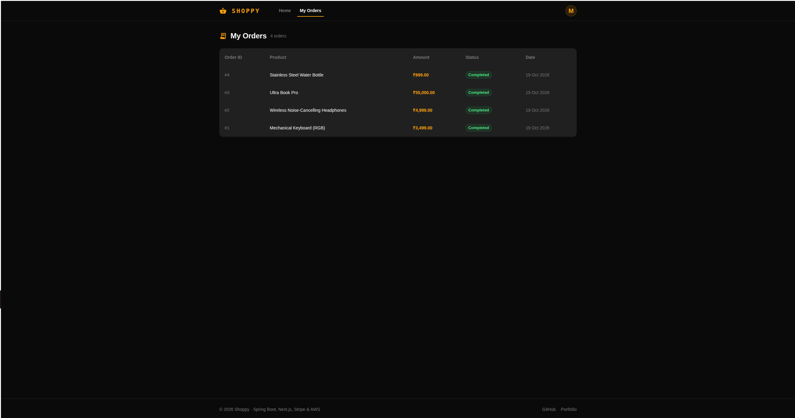
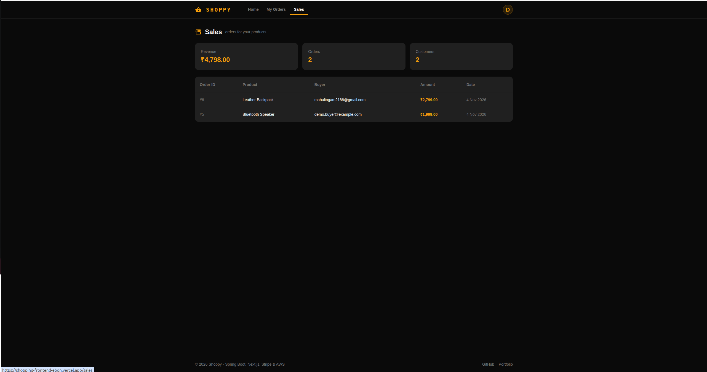

# Shoppy: Frontend

The Next.js storefront for Shoppy, a full-stack e-commerce marketplace with Stripe payments and real-time stock updates.

**[▶ Watch the 90-second demo](https://www.loom.com/share/9613a8520bd04a83b266ff9ff50295b4)** · **[Live app](https://shopping-frontend-ebon.vercel.app)** · **[Backend repo](https://github.com/mahalingam-dev-8/shoppy-backend)**

### Try it

| Role | Email | Password |
|---|---|---|
| Buyer | `demo.buyer@example.com` | `ShoppyDemo@2026` |
| Seller | `demo.seller@example.com` | `ShoppyDemo@2026` |

Payments run in Stripe test mode. Use card `4242 4242 4242 4242`, any future expiry date and any CVC.

> The backend runs on a free instance. If it has been idle, the first load can take up to a minute.

## Screenshots

| Storefront | Checkout |
|---|---|
|  |  |
| **My orders** | **Seller sales** |
|  |  |

## Features

- Buyers browse and pay. Sellers list products and see their revenue, orders and customers on a sales page.
- New and sold-out products show up for every shopper without a refresh, over a STOMP WebSocket.
- The JWT lives in an HttpOnly cookie handled by Server Actions, and protected pages are guarded in middleware.
- Checkout goes through Stripe, followed by a success page and an order history.

## Tech stack

Next.js 14 (App Router, Server Components, Server Actions) · TypeScript · Material UI · Tailwind CSS · Stripe · `@stomp/stompjs` · Vercel

<details>
<summary><b>Run locally</b></summary>

```bash
git clone https://github.com/mahalingam-dev-8/shopping-frontend.git
cd shopping-frontend
npm install
```

Create `.env.local`:

```env
NEXT_PUBLIC_API_URL=http://localhost:3001
NEXT_PUBLIC_STRIPE_PUBLIC_KEY=pk_test_...
```

```bash
npm run dev
```

The backend must be running at `NEXT_PUBLIC_API_URL`. See the [backend repo](https://github.com/mahalingam-dev-8/shoppy-backend) for setup.

</details>
